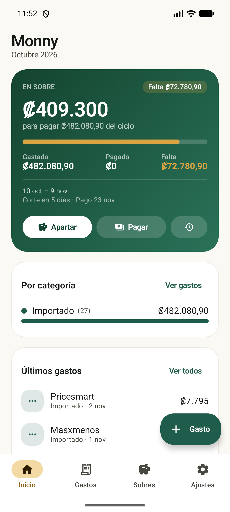
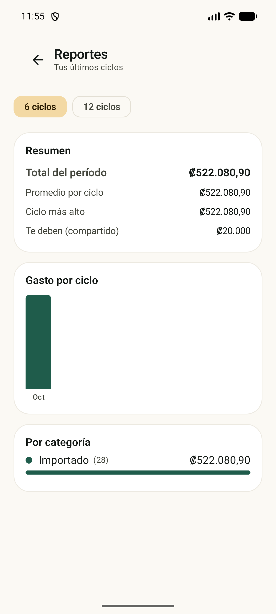
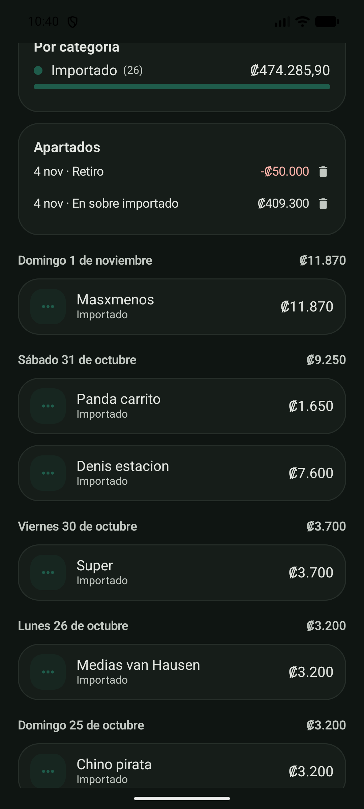

# Monny

App Android para llevar los gastos de tarjetas de crédito, el dinero apartado
("en sobre") y sobres de ahorro. Local, sin cuentas, sin internet.

📖 [Arquitectura del código](docs/ARQUITECTURA.md)

| Inicio | Reportes | Detalle de ciclo |
|---|---|---|
|  |  |  |

## Stack

- Kotlin + Jetpack Compose (Material 3)
- Room (SQLite) para los datos
- WorkManager para recordatorios de corte y pago
- AGP 9.3 / Gradle 9.5 / Kotlin 2.2

## Conceptos

- **Ciclo**: va de un corte al siguiente. Se calcula solo a partir del día de
  corte de cada tarjeta. Ej: corte el día 4 → el ciclo de octubre es del 5 de
  octubre al 4 de noviembre. El nombre del ciclo es el mes en que arranca, así
  que con corte el 9 el ciclo sigue siendo "octubre" hasta el 9 de noviembre.
  Las compras hechas el mismo día del corte se pueden mandar al ciclo siguiente
  (opción por tarjeta, activada por defecto). Si cambiás el día de corte, los
  gastos, pagos y apartados se reubican en los ciclos nuevos.
- **Gastos compartidos** (opcional, Ajustes): al registrar un gasto podés marcar
  qué porcentaje le corresponde a otra persona. En Inicio ves cuánto te deben y
  podés **registrar un abono** eligiendo si la plata va al "en sobre" del ciclo
  o a uno de tus sobres.
- **Gastos fijos**: seguros, suscripciones y cobros mensuales. Se crean solos en
  cada ciclo (también el próximo) mientras estén activos. Se administran en
  Ajustes → Gastos fijos.
- Al editar un gasto podés **elegir el ciclo** al que pertenece, además de la fecha.
- **Reportes**: totales por ciclo (6 o 12), promedio, gráfico de barras y
  desglose por categoría.
- **Tasa 0**: una compra dividida en cuotas mensuales. Cada ciclo recibe su
  cuota automáticamente y se muestra "Cuota 2/6" en el gasto. Se administran en
  Ajustes → Tasa 0 (editar monto, cuotas o categoría; eliminar deja las cuotas
  pasadas en el historial).
- **En sobre**: dinero apartado para pagar ese ciclo. Arranca en 0 cada ciclo.
  Se puede **apartar** o **retirar** (para emergencias) y después reponer.
- **Falta / A favor**: `gastado − pagado − en sobre`. Positivo = debés,
  negativo = te sobra.
- **Sobre**: bolsa de ahorro con saldo propio (tipo BCR). Se le puede aportar,
  retirar o pasar plata al ciclo de una tarjeta.
- **Pago**: abono a la tarjeta, opcional, con fecha y foto del comprobante.
  No descuenta el "en sobre" automáticamente: son dos cosas distintas
  (lo apartado y lo ya pagado).

## Qué está hecho

- Tarjetas con día de corte, días para pagar (14 por defecto) y avisos.
- Ciclos calculados automáticamente; nunca hay que crear un "mes".
- Gastos con monto, categoría, motivo, nota, fecha y comprobante.
- Presupuesto por categoría (opcional, por ciclo) con avance y aviso de "te pasaste".
- Subtotal por categoría, total del ciclo y panorama "en sobre".
- Sobres con saldo, aportes, retiros y traspaso al ciclo de una tarjeta.
- Pagos con fecha y comprobante.
- Historial de ciclos (con opción de eliminar un cierre completo).
- **Pago pendiente** del último ciclo cerrado en Inicio, con su vencimiento y botón Pagar.
- Borrar todos los datos desde Ajustes → Datos (con confirmación escribiendo BORRAR).
- Recordatorios diarios (corte y vencimiento) con WorkManager.
- Tema claro/oscuro/sistema.
- Todo local, sin permisos de internet.

## Pendiente / próximas fases

- Presupuesto por categoría con alertas.
- Captura automática: notificaciones del banco o Gmail (fase 2).
- Widget de pantalla de inicio y atajos.

## Importar y exportar

En Ajustes → Datos:

- **Respaldo completo (JSON)**: exporta tarjetas, categorías, presupuestos, gastos,
  pagos, sobres y movimientos. Restaurar reemplaza todo.
- **CSV de gastos**: para abrir en Excel o Google Sheets.
- **Importar desde CSV o Google Sheets**: detecta hojas con bloques
  (Fecha / Motivo / Monto por categoría) y tablas planas. También importa el
  "En sobre" de la hoja y los pagos (montos negativos), con interruptores en la
  vista previa.

El único uso de internet es descargar la hoja cuando se pega un enlace.


## Estructura

```
app/src/main/java/cr/monny/
├── data/          entidades, DAOs, base de datos, repositorio, preferencias
├── domain/        cálculo de ciclos y formato de montos (₡)
├── notifications/ recordatorios con WorkManager
└── ui/
    ├── theme/     colores, tipografía, formas
    ├── components/ piezas reutilizables
    ├── sheets/    hoja de "nuevo/editar gasto"
    └── screens/   inicio, gastos, sobres, ajustes, tarjetas, categorías...
```

## Compilar

Con Android Studio: abrir la carpeta y correr `app`.

Por consola (usando el JDK de Android Studio):

```powershell
$env:JAVA_HOME="C:\Program Files\Android\Android Studio\jbr"
.\gradlew.bat :app:assembleDebug     # para probar
.\gradlew.bat :app:assembleRelease   # APK para compartir
```

El APK de release queda en `app/build/outputs/apk/release/app-release.apk`.

## Firma y actualizaciones

- El release se firma con `keystore/monny-release.jks` (datos en
  `keystore.properties`). **Guardá esos dos archivos**: con ellos se pueden
  publicar actualizaciones que se instalan encima sin borrar datos.
- Esos archivos **no están en el repositorio** (por seguridad). Si clonás el
  proyecto, generá tu propio keystore y creá `keystore.properties` para poder
  compilar un release firmado; el debug funciona sin nada extra.
- Si se pierde la llave, Android obliga a desinstalar para poder instalar otra
  versión (y se pierden los datos locales).
- Actualizar con la misma firma conserva todo. Las migraciones de Room están
  versionadas (1→2→3→4→5→6) para no perder datos.

## Respaldos

- Manual: Ajustes → Datos → Exportar (JSON).
- Automático: al abrir la app, una vez por día, se guarda
  `Descargas/Monny/monny-AAAA-MM-DD.json` (se conservan los últimos 5).

